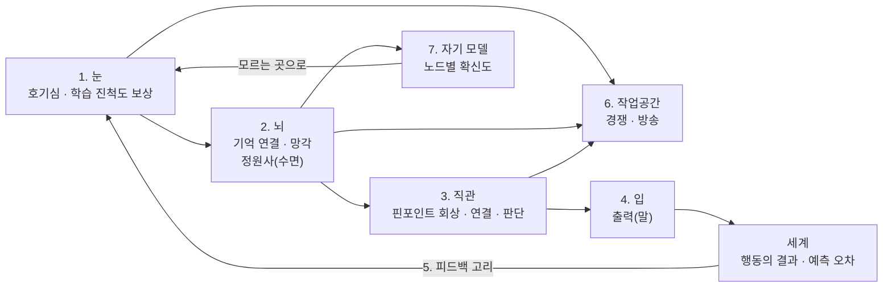

# Memoria 설계 지침

작성일: 2026-10-12 · 작성자: 최민준 (Illo)

## 개요

Memoria는 사람보다 뛰어난 AGI가 아니라, 사람처럼 배우고 잊고 다시 배우는 시스템을 만드는 개인 연구다. 연구실 과제와 분리해 로컬 장비와 GitHub로 진행한다.

핵심 문제의식은 온라인 가소성이다. 현재 LLM은 배포 시점에 가중치가 고정되고, 기억은 외부 메모를 다시 읽는 방식에 머문다. 지식의 폭이 아니라 처음 보는 일을 적은 경험으로 배우고 유지하는 능력이 사람과의 결정적 차이다.

지능의 기준은 기술을 얼마나 갖고 있느냐가 아니라 새 기술을 얼마나 효율적으로 습득하느냐로 둔다.

## 구성 한눈에 보기

뇌(기억)가 중심이고, 입에서 나간 행동의 결과가 세계를 거쳐 다시 눈으로 돌아와 기억을 고친다. 자기 모델은 확신도가 낮은 곳으로 호기심을 보낸다.

## 구성 요소별 상세

| 구성 요소 | 역할 | 설계 방향 | 대응하는 뇌 기능·연구 |
| --- | --- | --- | --- |
| 1. 눈 | 새로운 것을 스스로 찾아가는 호기심, 탐구심 | 보상은 예측 오차가 아니라 학습 진척도. 좁은 시야 + 시선 제어(active sensing)로 주의를 행동으로 둔다 | 도파민 계열 보상, Oudeyer의 learning progress, noisy TV 문제 회피 |
| 2. 뇌 | 기억의 생성·연결·망각, 학습력 | 노드 기반 연상 기억, 함께 활성화되면 연결 강화(Hebbian), 안 쓰면 감쇠. 중요도는 저장 시점이 아니라 통합 단계에서 예측 오차로 재평가 | 해마-피질 Complementary Learning Systems |
| 2-1. 정원사 | 가소성 유지 | 수면 단계: 재생(replay), 시냅스 하향 조정, 죽은 뉴런 재활용, 새 뉴런 생성. 복습에도 가중치 | Tononi 시냅스 항상성 가설, continual backprop, ReDo |
| 3. 직관 | 맥락에 따른 핀포인트 회상, 주변 기억 연결, 판단 | 일부 단서로 관련 노드만 활성화해 전체 기억 복원 | 해마 패턴 완성, spreading activation, Hopfield 연상 기억 |
| 4. 입 | 외부 출력 | 단어 생성이 1차, 이미지 등은 다음 단계 | — |
| 5. 피드백 고리 | 실수로부터 배움 | 입 → 세계 → 눈으로 닫힌 고리. 행동 결과의 예측 오차가 기억을 고친다 | predictive coding, model-based RL |
| 6. 작업공간 | 주의의 병목 | 눈·뇌·직관의 정보가 좁은 자리를 두고 경쟁, 이긴 것만 전체에 방송 | Global Workspace Theory |
| 7. 자기 모델 | 내가 무엇을 알고 모르는지 | 기억 노드마다 확신도. 확신도 낮은 영역으로 호기심을 향하게 함 | 고차 이론, 보정된 확률(Jev 류) |

## 설계 원칙

- **하나의 기억 구조, 여러 방향의 사용.** 구성 요소는 독립 모듈이 아니다. 호기심은 기억과 비교해야 새로움을 알고, 직관은 기억의 연결 구조를 따라간다.
- **사람의 장치를 구현하는 것은 치트가 아니다.** 복습, 수면, 망각, 가지치기는 사람에게 이미 있는 장치다.
- **사람다운 한계는 목표의 일부다.** 관심의 표류, 덜 중요한 것의 망각, 나이에 따른 학습 속도 저하는 결함이 아니라 재현 대상이다.
- **단, 신경망 고유의 실패는 고쳐야 한다.** 겹침에 의한 망각(중요도와 무관하게 덮어씀)과 가소성 손실(새로 배우는 능력 자체가 사라짐)은 사람에게 없는 현상이다.
- **역전파와 국소 학습의 역할 분담.** 감각 인코더는 역전파로 천천히, 기억 그래프는 국소 규칙으로 빠르게 학습한다.
- **평가 기준은 성능이 아니라 사람과의 유사성.** 학습·망각·재학습 곡선이 사람 데이터와 얼마나 닮았는지로 잔다. 가소성은 초기에 높고, 서서히 줄고, 0이 되지 않아야 한다.

## 단계별 로드맵

1. **1단계: 기존 네트워크 + 정원사.** 구조는 그대로 두고 수면 단계(재생, 하향 조정, 뉴런 재활용, 성장)를 하나의 주기로 묶는다. 비교 대상은 정원사 없는 네트워크.
   1. 시작 환경: 분포 변화가 있는 작은 환경(그리드월드 등)
   2. 검증: 분포 변화 후 적응 속도, 이전 조건 복귀 시 성능 유지, 학습 진척도 기반 호기심이 관심을 옮길 때 이전 능력이 얼마나 무너지는지
2. **2단계: 국소 학습 규칙.** 1단계에서 정원사로 안 풀리는 한계(예: 중요한 기억이 겹침 때문에 날아감)가 실험으로 드러나면, 그것을 근거로 노드 그래프 위의 국소 학습 규칙을 제안한다.
3. **이후: 작업공간, 자기 모델, 입의 확장(이미지 등).**

진행 원칙: 처음엔 읽기 위주로 주당 일정 시간만 쓰고, 중간 결과는 GitHub과 arXiv·워크숍·블로그에 꾸준히 남긴다.

## 미결 질문

- [ ] 판단이 기억 그래프의 활성화 패턴에서 직접 나오는가, 별도 네트워크가 그래프를 읽어 내리는가? 전자면 새로운 구조, 후자면 RAG 계열에 가까워진다.
- [ ] 노드의 단위는 무엇인가? 단어 단위는 의미와 관계를 잃으므로 최소 개념·사건 단위, 엣지는 관계로 둘 후보.
- [ ] 노드 배치: 가상 좌표 기반 지형도. 새 노드는 가장 연관된 기존 노드 근처에 생성하고, 먼 연결에는 비용을 매긴다. 근처만 훑는 빠른 회상과 클러스터 기반 추상화가 따라온다(Kohonen SOM, Achterberg 등 2023 spatially embedded RNN).
- [ ] 걸려 있는 것(내부 상태, homeostasis)을 어떤 변수로 둘 것인가?
- [ ] 사람의 학습·망각 곡선 비교에 어떤 사람 데이터를 쓸 것인가?
- [ ] 의식 여부는 판정 대상이 아니다. 기능과 구조, 즉 의식 이론들의 지표를 얼마나 갖추는지로만 본다.

## 참고 연구

아래는 대화 중 언급한 연구로, Jev 외에는 링크를 직접 확인하지 않았다. 인용 전 원문 확인이 필요하다.

| 주제 | 연구 |
| --- | --- |
| 지능의 정의 | Chollet, On the Measure of Intelligence (2019), ARC 벤치마크 |
| 기억 이론 | McClelland 등, Complementary Learning Systems (1995) |
| 연상 확산 | Collins & Loftus, spreading activation (1975) |
| 연상 기억 | Ramsauer 등, Hopfield Networks is All You Need (2020) |
| 기억 기반 에이전트 | Park 등, Generative Agents (2023) · MemGPT (2023) · HippoRAG (2024) · Voyager (2023) |
| 호기심 | Pathak 등, ICM (2017) · Burda 등, noisy TV (2018) · Oudeyer, learning progress |
| 항상성 | Keramati & Gutkin, homeostatic RL (2014) |
| 가소성 손실 | Dohare 등, Nature (2024) · Sokar 등, ReDo (2023) · Ash & Adams, shrink-and-perturb (2020) |
| 수면·재생 | Tadros 등, sleep-like replay (2022) · Tononi, 시냅스 항상성 가설 |
| Open-endedness | POET (2019) · OMNI (2023) |
| 의식 | Butlin, Long 등, Consciousness in AI (2023) |
| System One 모델 | [Jev 소개 (Sanity)](https://www.sanity.io/glossary/jev-typesafe-ai-model) · [Jev 벤치마크 (arXiv)](https://arxiv.org/pdf/2609.37647) |
