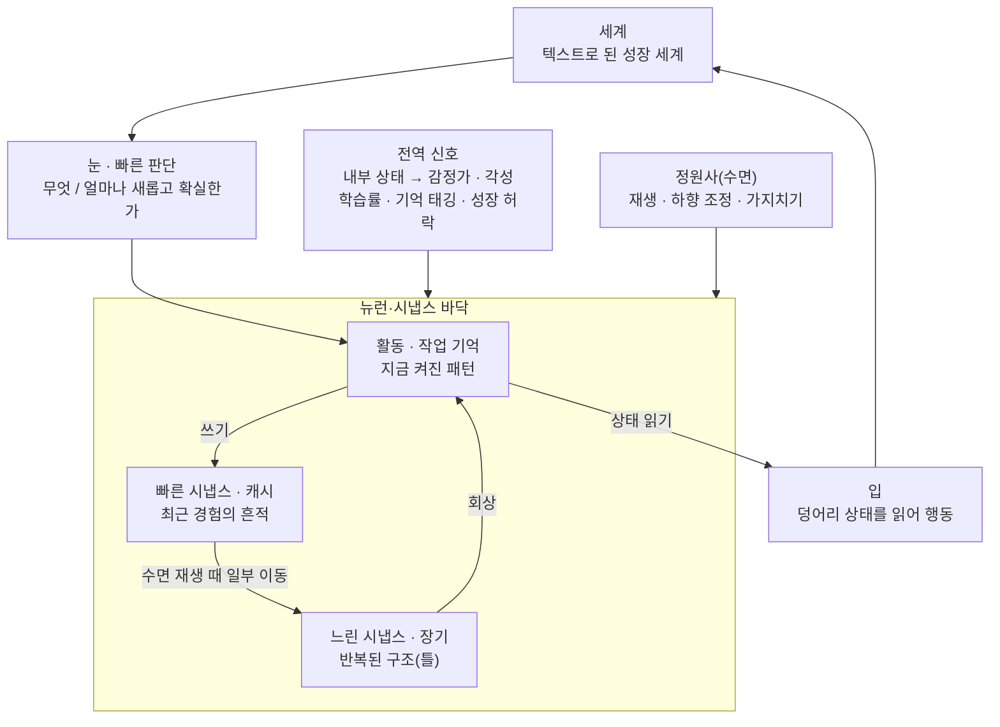

# Memoria 설계 지침

작성일: 2026-10-12 · 작성자: 최민준 (Illo)

## 개요

Memoria는 사람보다 뛰어난 AGI가 아니라, 사람처럼 배우고 잊고 다시 배우는 시스템을 만드는 개인 연구다. 연구실 과제와 분리해 로컬 장비와 GitHub로 진행한다.

핵심 문제의식은 온라인 가소성이다. 현재 LLM은 배포 시점에 가중치가 고정되고, 기억은 외부 메모를 다시 읽는 방식에 머문다. 지식의 폭이 아니라 처음 보는 일을 적은 경험으로 배우고 유지하는 능력이 사람과의 결정적 차이다.

지능의 기준은 기술을 얼마나 갖고 있느냐가 아니라 새 기술을 얼마나 효율적으로 습득하느냐로 둔다.

## 연구 동기 (논문 서론의 뼈대)

한 줄 주장: Memoria는 배포 뒤에도 **진짜 배울 수 있는** 시스템이 가능함을 보인다. 필요한 만큼만 학습해 출시하는 것은 상품화이고, Memoria는 학습-응용이 계속 일어나는 구조가 가능함을 증명하는 연구다.

**왜 온라인 가소성인가**

- 얼어붙은 모델은 세상이 바뀔 때마다 데이터 수집 → 재학습 → 재배포를 반복해야 한다. 현장에서 스스로 배우면 이 순환이 줄고, 데이터를 밖으로 보내지 않아도 된다.
- 지식의 폭이 아니라 처음 보는 일을 적은 경험으로 배우고 유지하는 능력이 사람과의 결정적 차이다.

**왜 성장인가 (처음부터 큰 가소적 네트워크와의 비교)**

1. 평생 필요한 용량을 미리 알 수 없다. 크게 잡으면 대부분 놀고, 작게 잡으면 가득 차서 기억끼리 섞인다.
2. 같은 뉴런 수라도 새로운 경험이 몰린 영역에 더 배치되어 구분이 세밀해진다.
3. 메모리·전력이 한정된 엣지 장비에서는 작게 시작해 필요한 만큼 키우는 것이 유일한 선택지일 수 있다.
4. 유아기 기억 상실 같은 발달 현상은 성장에서만 나온다.

1, 2는 고정 크기 버전과의 비교 실험으로 보이고, 3은 동기, 4는 Memoria만의 무기다. "기업에 유리해서" 같은 동기 추측은 논거로 쓰지 않는다.

**응용 비전**: 가상 세계(장기적으로는 완전 몰입형 가상현실) 안에 사는 존재. 플레이어를 기억하고, 함께한 일로 바뀌고, 각자 다른 경험으로 다른 성격을 갖는 NPC. 가까운 데모로는 같은 Memoria를 여러 사람과 각자 다르게 키우는 것.

## 구성 한눈에 보기

설계하는 것은 가운데 바닥(뉴런·시냅스 규칙), 전역 신호, 정원사뿐이다. 경험은 활동에서 빠른 시냅스로 쓰이고, 수면 때 일부만 느린 시냅스로 옮겨지며, 단서가 들어오면 관련된 패턴만 활동으로 끌어올려진다. 아래 구성 요소 표는 만들 부품이 아니라 이 바닥에서 창발해야 할 기능의 체크리스트로 읽는다.

## 창발 사다리

'왜?'까지 오르면 절반 성공이다. 눈(탐구심)이 자리 잡고 뇌가 그것을 받칠 만큼 자랐다는 증거이기 때문이다. 나머지 절반은 얻은 연결을 처음 보는 상황에 쓰는 직관과 응용력이다. 첫 실험은 아래 칸에서 시작한다.

1. **습관화**: 아는 게 쌓일수록 같은 자극에 무뎌진다.
2. **망각**: 유아기 기억 상실, 대화 망각처럼 사건은 흐려지고 구조는 남는다.
3. **되뇌기**: 가르쳐준 전략을 나중에 지시 없이 새 상황에서 스스로 쓴다.
4. **단어의 의미**: 글자 흐름에서 단어 경계를 찾고(Saffran 1996), 보이는 채널의 특징 묶음과 들리는 채널의 말을 잇는다. 두 경로: 가리키고 이름 듣기(튜터 필요), 여러 장면에서 겹쳐보기(교차 상황 학습, Smith & Yu 2008). 기호 접지가 처음 일어나는 칸이며 아기 실험 수치와 직접 비교할 수 있다.
5. **'뭐야?'**: 불편하면 신호를 내보낸다(타고남) → 반응이 상황을 바꾼다는 경험 → 모르는 것을 가리키고 이름을 묻는다.
6. **'왜?' (절반)**: 예측은 되지만 다른 지식과 연결되지 않은 지식이 불편하다(에너지 비용에서 나오는 압축 욕구). 물었더니 설명을 듣고 연결되어 개운해진 경험이 쌓여 '왜'가 연결 요청 도구가 된다. 답해줄 존재에 대한 믿음이 전제다.
7. **새 상황에 응용 (나머지 절반)**: 예: 하늘이 파란 이유를 배운 뒤 노을이 왜 빨간지 스스로 추측한다.

호기심은 별도 모듈이 아니라 한 뿌리에서 두 갈래로 나온다: 예측이 좋아지는 느낌(학습 진척)과 표현이 싸지는 느낌(압축 진척). 둘 다 에너지 절약에서 나온다: 잘 예측된 입력은 뉴런을 덜 켜고, 연결된 지식은 자원을 덜 쓴다. 성실하게 반응하는 가르치는 존재가 세계에 있어야 4~6칸이 열린다.

## 구성 요소별 상세

| 구성 요소 | 역할 | 설계 방향 | 대응하는 뇌 기능·연구 |
| --- | --- | --- | --- |
| 1. 눈 | 새로운 것을 스스로 찾아가는 호기심, 탐구심 | 보상은 예측 오차가 아니라 학습 진척도. 좁은 시야 + 시선 제어(active sensing)로 주의를 행동으로 둔다 | 도파민 계열 보상, Oudeyer의 learning progress, noisy TV 문제 회피 |
| 2. 뇌 | 기억의 생성·연결·망각, 학습력 | 노드 기반 연상 기억, 함께 활성화되면 연결 강화(Hebbian), 안 쓰면 감쇠. 중요도는 저장 시점이 아니라 통합 단계에서 예측 오차로 재평가 | 해마-피질 Complementary Learning Systems |
| 2-1. 정원사 | 가소성 유지 | 수면 단계: 재생(replay), 시냅스 하향 조정, 죽은 뉴런 재활용, 새 뉴런 생성. 복습에도 가중치 | Tononi 시냅스 항상성 가설, continual backprop, ReDo |
| 3. 직관 | 맥락에 따른 핀포인트 회상, 주변 기억 연결, 판단 | 일부 단서로 관련 노드만 활성화해 전체 기억 복원 | 해마 패턴 완성, spreading activation, Hopfield 연상 기억 |
| 4. 입 | 외부 출력 | 단어 생성이 1차, 이미지 등은 다음 단계 | — |
| 5. 피드백 고리 | 실수로부터 배움 | 입 → 세계 → 눈으로 닫힌 고리. 행동 결과의 예측 오차가 기억을 고친다 | predictive coding, model-based RL |
| 6. 작업공간 | 주의의 병목 | 눈·뇌·직관의 정보가 좁은 자리를 두고 경쟁, 이긴 것만 전체에 방송 | Global Workspace Theory |
| 7. 자기 모델 | 내가 무엇을 알고 모르는지 | 기억 노드마다 확신도. 확신도 낮은 영역으로 호기심을 향하게 함 | 고차 이론, 보정된 확률(Jev 류) |

## 설계 원칙

- **하나의 기억 구조, 여러 방향의 사용.** 구성 요소는 독립 모듈이 아니다. 호기심은 기억과 비교해야 새로움을 알고, 직관은 기억의 연결 구조를 따라간다.
- **사람의 장치를 구현하는 것은 치트가 아니다.** 복습, 수면, 망각, 가지치기는 사람에게 이미 있는 장치다.
- **사람다운 한계는 목표의 일부다.** 관심의 표류, 덜 중요한 것의 망각, 나이에 따른 학습 속도 저하는 결함이 아니라 재현 대상이다.
- **단, 신경망 고유의 실패는 고쳐야 한다.** 겹침에 의한 망각(중요도와 무관하게 덮어씀)과 가소성 손실(새로 배우는 능력 자체가 사라짐)은 사람에게 없는 현상이다.
- **바닥 전체를 국소 규칙으로 학습한다. 역전파는 쓰지 않는다.** 감각은 타고난 고정 기관(음소 귀·특징 눈)이고, 그 뒤의 모든 변화는 순서 의존 가소성 × 허락 신호, 억제, 성장·제거로만 일어난다. 단, 주장은 "역전파가 틀렸다"가 아니라 "국소 규칙만으로 이것이 가능하다"로 한다.
- **평가 기준은 성능이 아니라 사람과의 유사성.** 학습·망각·재학습 곡선이 사람 데이터와 얼마나 닮았는지로 잰다. 가소성은 초기에 높고, 서서히 줄고, 0이 되지 않아야 한다.
- **핵심 주장과 무관한 부분은 과감하게 단순화하고, 단순화했다고 밝힌다.** 말소리·시각·튜터·언어는 기억과 학습의 원리를 시험하는 무대 장치다. 예: 음소 범주는 주어진 것으로 두고(이름표 또는 특징 묶음), 진짜 소리와 성도 합성은 나중의 확장으로 미룬다.

## 단계별 로드맵

1. **1단계: 바닥 구축.** 구현 준비의 ①~③(작은 망 + 순서 의존 가소성 + 억제 → 빠른·느린 시냅스 + 수면 → 성장·제거 + 에너지). 습관화, 캐시와 장기 기억 분리, 유아기 기억 상실을 차례로 확인한다. 비교 대상은 같은 바닥에서 성장·수면을 끈 버전.
2. **2단계: 기호 접지.** 구현 준비의 ④(두 채널 세계 + 튜터). 단어 경계(E2a), 단어와 사물 잇기(E2b)를 아기 실험 수치와 비교한다.
3. **이후: 작업공간, 자기 모델, 입의 확장(이미지 등).**
4. **마지막 단계: Memoria 사회.** 여러 개체를 한 세계에 풀어놓고 소문의 변형과 집단 상식의 창발을 관찰한다. 전달 오류는 따로 넣지 않고 망각·재응고화에서 저절로 생기게 한다(Bartlett 연쇄 재생, Kirby 반복 학습 참고).

진행 원칙: 처음엔 읽기 위주로 주당 일정 시간만 쓰고, 중간 결과는 GitHub과 arXiv·워크숍·블로그에 꾸준히 남긴다.

## 구현 준비

순서: 설계 마무리 → 핵심 논문 읽기 → 첫 실험 명세서 → 도구·환경 고르기(① 단계를 돌릴 수 있는지만 확인) → 쌓아 올리는 순서대로 구현.

쌓아 올리는 순서: ① 고정된 작은 망 + 순서 의존 가소성 + 억제 → 습관화 확인 ② 빠른·느린 시냅스 + 수면 → 캐시와 장기 기억 분리 확인 ③ 성장·제거 + 에너지 → 폭발과 정리 확인 ④ 두 채널 세계 + 튜터 → 기호 접지.

### 읽을 목록

| 우선 | 논문 | 왜 읽나 |
| --- | --- | --- |
| 1 | Lazar 등 2009, SORN | 순서 의존 가소성·억제·항상성으로 스스로 조직되는 순환망. Memoria 바닥과 가장 가까운 선행 연구 |
| 1 | Song, Miller, Abbott 2000 | 순서 의존 가소성(STDP)의 기본 모델 |
| 1 | Gerstner 등 2018 | 3요소 학습과 적격 흔적(허락 신호·꼬리표) 리뷰 |
| 1 | Saffran, Aslin, Newport 1996 | 단어 경계 찾기. 실험 E2a의 비교 기준 |
| 1 | Smith & Yu 2008 | 교차 상황 단어 학습. 실험 E2b의 비교 기준 |
| 2 | Dohare 등 2024 | 가소성 손실. 성장·뉴런 재활용의 근거 |
| 2 | Akers 등 2014 | 유아기 신경 생성과 망각 |
| 2 | Tse 등 2007 | 스키마가 있으면 장기화가 빨라짐 |
| 2 | Dasgupta 등 2017 | 초파리 버섯체 = 유사도 해싱 |
| 2 | Vong 등 2024 | 아기 시점 데이터로 0에서 단어 학습. 차별점 확인용 |
| 2 | McClelland 등 1995 | Complementary Learning Systems |
| 3 | Hinton & Plaut 1987 | 빠른 가중치(두 시간척도 시냅스) |
| 3 | Fritzke 1995 · Grossberg ART | 성장하는 망, 새 단위를 만드는 기준 |
| 3 | Frey & Morris 1997 | 시냅스 태깅과 포획 |
| 3 | Loewenstein 1994 · Oudeyer | 정보 간극 이론, 학습 진척 호기심 |

### 첫 실험 명세서

원칙: 결과를 보기 전에 성공 기준을 고정한다. 바꾸게 되면 날짜와 이유를 남긴다.

**E1. 습관화 (바닥 점검, 구현 ① 단계)**

- 넣는 것: 소수의 감각 기호. 같은 순서 패턴(A B C)을 반복하다가, 새 패턴과 같은 기호의 다른 순서(C A B)를 섞는다.
- 재는 것: 켜지는 뉴런 수(활동량 = 에너지), 다음 입력이 미리 켜지는 정도(예측), 새 패턴에서의 반등.
- 성공 기준: 반복할수록 활동량이 줄고, 새 패턴과 순서만 바꾼 패턴 모두에서 반등이 일어난다. 순서 반등은 단순 반복이 아니라 순서를 학습했다는 증거다.
- 실패 해석: 감소가 없으면 학습 규칙·억제 문제. 감소는 있는데 반등이 없으면 학습이 아니라 피로일 수 있다.

**E2a. 단어 경계 (기호 접지 1부, Saffran 1996 대응)**

- 넣는 것: 세 음절짜리 무의미 단어 4개를 쉼 없이 이어 붙인 흐름. 단어 안의 음절 전이 확률 1.0, 단어 사이 약 0.33. 노출 양은 Saffran 실험의 8개월 아기와 같은 수준.
- 재는 것: 시험 단계에서 단어와 부분 단어(단어 경계에 걸친 음절 묶음)에 대한 예측·놀람 차이.
- 성공 기준: 아기와 같은 노출 양 안에서 단어와 부분 단어를 구분한다.

**E2b. 단어와 사물 잇기 (기호 접지 2부, Smith & Yu 2008 대응)**

- 넣는 것: 사물 6개(특징 묶음), 단어 6개. 시행마다 사물 2개와 단어 2개를 함께 제시해 한 번만 봐서는 어느 단어가 어느 사물인지 알 수 없게 한다. 무작위 순서 30시행. 가리키기·튜터 없음.
- 재는 것: 시험에서 단어 하나와 사물 두 개(정답·오답)를 줄 때, 정답 사물의 특징이 미리 켜지는 정도와 시선이 가는 쪽.
- 성공 기준: 우연보다 높은 수준으로 정답 쪽을 고른다. 비교 기준: 12·14개월 아기는 30시행, 4분 미만의 노출로 6쌍을 배웠고 14개월이 더 잘했다.
- 다음 확장: 가리키고 이름 듣기 조건이 학습을 앞당기는지, 빠른 연결과 어휘 폭발이 나오는지(아이 어휘 규준 데이터 필요).

## 결정 기록

| 날짜 | 결정 | 이유 |
| --- | --- | --- |
| 2026-10-12 | 충분히 토론한 뒤 구현한다. 구현은 마지막 직전 단계 | 결정을 코드가 대신 내리지 않게 하기 위해 |
| 2026-10-12 | 메커니즘(기억·학습·정원사·호기심·가치)을 먼저 정하고, 구체 환경과 과제는 나중에 고른다. 단, 세계의 성질(변한다, 일부만 보인다, 걸려 있는 게 있다)과 측정 종류(성능이 아니라 학습·망각·재학습 동역학)는 먼저 정한다 | 과제가 설계를 끌고 가면 범용성을 잃는다. 반대로 세계에 대한 가정이 없으면 설계 선택의 근거가 없다 |
| 2026-10-12 | 지식은 0, 메커니즘만 타고난다 | 완전한 0은 학습 자체가 불가능하다. 세상을 보는 방식은 주고 세상에 대한 사실은 주지 않는다 |
| 2026-10-12 | 타고나는 가치는 소수만 둔다. 내부 상태 변수(몸)와 그것을 감정가(좋다↔나쁘다)·각성(들뜸↔가라앉음) 두 축으로 번역하는 고정 규칙(느낌). 중요도, 취향, 좋고 싫음은 전부 그 위에서 학습한다 | 전부 학습은 무한 후퇴에 빠진다. 사람도 1차 가치는 타고나고 나머지는 경험으로 생긴다(핵심 정서, Russell·Barrett) |
| 2026-10-12 | 설계 대상은 기능 부품이 아니라 뉴런·시냅스의 바닥이다. 노드는 뉴런, 개념·기억은 여러 뉴런의 활성화 패턴, 회상은 패턴 완성. 입력→출력으로 달려가는 파이프라인이 아니라 계속 활동하는 덩어리를 입력이 흔들고, 출력은 그 상태를 읽어낸 것. 바닥은 세 겹: 뉴런·시냅스 규칙(생성·연결·강화·약화·제거), 작은 유전체(성장 경향, 초기 연결 편향), 전역 신호(감정가·각성). 7개 구성 요소는 만들 부품이 아니라 창발 여부를 확인할 체크리스트 | 가장 단순한 기전에서 가장 복잡한 결과가 나와야 한다. 단, 완전히 균일한 바닥은 현실적 시간 안에 분화하지 않으므로 최소한의 구조적 편향은 준다 |
| 2026-10-12 | 눈의 입구에 빠른 판단을 둔다. 눈은 감각을 두 가지로 내보낸다: 무엇인가(정보화된 표현), 얼마나 새롭고 확실한가(빠른 판단 + 확신도). 후자가 성장의 문지기 신호가 된다: 기존 패턴으로 설명 안 되는 입력이 쌓이고 각성이 높으면 그 근처에 새 뉴런, 함께 켜지는 가까운 뉴런 사이에 허락 신호가 있으면 새 시냅스, 오래 안 쓰이면 제거. Jev는 모델 자체가 아니라 형태(생성 없이 한 번에 판단, 정해진 형태의 답, 보정된 확신도)만 빌리고 판단 기준은 비어서 시작한다 | 뇌의 빠른 경로(LeDoux)와 3요소 학습 규칙에 대응. Jev를 그대로 쓰면 외부 지식이 들어와 '지식 0' 결정이 깨진다. 생성 기준은 ART(Grossberg)·Growing Neural Gas(Fritzke) 참고 |
| 2026-10-12 | 성장 속도를 별도 일정으로 줄이지 않는다. 새로움은 이미 아는 것과의 비교로 판단하므로, 아는 게 쌓일수록 자극에 무뎌지고 성장이 자연히 줄어든다(습관화). 새 환경에서는 다시 늘어난다 | 사람과 같은 방식이고, 따로 규칙을 넣지 않아도 창발하는 현상이라 설계 원칙(최소 기전)에 맞는다 |
| 2026-10-12 | 초반 성장 폭발은 막지 않는다. 마음껏 자라게 두고, 에너지 비용과 미사용 제거로 대정리가 일어나게 한다. 이때 초기 사건 기억은 흐려지고 반복해서 쓰인 일반화된 구조만 남아야 한다. 유아기 기억 상실이 따로 규칙 없이 나타나는지를 창발 체크리스트의 핵심 검증 항목으로 둔다 | 빠르게 자라는 뇌는 빠르게 잊는다(Akers 등 2014, Science: 유아기 신경 생성이 기억 회로를 흐트러뜨림). 잊힌 기억도 흔적은 남아 접근만 끊긴다(Guskjolen 등 2018). 사람과 같은 기전에서 사람과 같은 망각이 나오면 가장 강한 검증이 된다 |
| 2026-10-12 | 모든 경험은 먼저 캐시(단기)에 들어가고 일부만 장기로 올라간다. 별도 저장소 대신 시냅스 하나에 두 강도를 둔다: 빨리 변하고 빨리 사라지는 강도(캐시), 천천히 변하고 오래 남는 강도(장기). 경험은 빠른 쪽에만 쓰이고 수면 재생 때 일부가 느린 쪽으로 옮겨진다. 이동 속도는 기존 틀과 얼마나 맞는지로 정해져, 캐시·장기 비중 변화가 일정 없이 창발한다 | 시스템 응고화(해마→피질)와 Complementary Learning Systems에 대응하고, 저장 시점 중요도 판단 문제를 해결한다. 스키마가 있으면 장기화가 빨라진다(Tse 등 2007, Science). 두 시간척도 시냅스는 Hinton & Plaut(1987) 빠른 가중치와 같고, 새 모듈 없이 시냅스 규칙 하나로 구현돼 최소 기전 원칙에 맞는다 |
| 2026-10-12 | 입의 출력이 세계를 거치지 않고 바로 눈으로 돌아가는 안쪽 고리를 연다(속으로 되뇌기). 되뇌기는 하나의 행동으로 두고, 언제 되뇔지는 경험으로 학습한다. 창발 체크리스트에 '되뇌기'를 추가하되, 검증 기준은 혼자 발명하는지가 아니라 가르쳐준 전략을 나중에 지시 없이 새 상황에서 스스로 쓰는지로 둔다 | 새 기전 없이 기존 구조(빠른 시냅스 반복 기록 → 수면 때 장기화)가 처리한다. 작업 기억의 음운 고리, 깨어 있을 때의 해마 재생(Foster & Wilson 2006)에 대응. 아이들은 되뇌기를 할 줄 알아도 시키지 않으면 안 하며(Flavell 1966), 기억 전략은 상당 부분 교육으로 전해진다 |
| 2026-10-12 | 학습 규칙: 순서대로 켜짐(STDP) → 빠른 강도에 항상 기록. 허락 신호(감정가·각성)는 꼬리표를 남겨 수면 때 무엇을 느린 강도로 옮길지 정한다(모순 점검에서 수정). A 직후 B가 켜지면 A→B가 강해지므로 A가 켜질 때 B가 미리 켜진다(예측). 실제 입력이 미리 켜진 것과 어긋나는 것 자체가 예측 오차이며, 별도의 오차 계산 장치는 두지 않는다. 이 한 줄에서 예측·새로움·습관화·예측의 호기심이 나오고, 에너지 비용과 합쳐져 설명의 호기심이 나온다 | 함께 켜짐만으로는 '예상'이 없어 눈의 새로움 판단, 뉴런 생성 조건, 예측의 호기심을 만들 수 없다. 순서 의존 규칙은 실제 시냅스의 동작이고, 버섯체의 3요소 학습과 결합하면 최소 기전 원칙을 지키면서 빈칸이 채워진다. 예측 부호화 네트워크는 별도 오차 뉴런이 필요해 후순위 대안으로 둔다 |
| 2026-10-12 | 모순 점검 결과 다섯 가지. ① 빠른 기록은 허락 없이 항상, 허락 신호는 장기 이동만 정한다. ② 에너지는 공급이 있는 내부 상태 변수: 유년기엔 공급이 넉넉해 마음껏 자라고, 평상시로 줄면 정리된다. 공급은 세계(돌보는 존재)가 준다. ③ 활동을 희소하게 유지하는 억제를 타고나는 규칙에 추가. ④ 작은 유전체에 잘 자라는 영역(빠른 저장 쪽)과 안정적인 영역(장기 쪽)의 편향을 둔다. ⑤ 학습 진척은 별도의 타고난 가치가 아니다: 잘 예측된 입력은 뉴런을 덜 켜므로 에너지 절약에서 나온다. 타고나는 가치는 내부 상태(몸) 하나로 충분하다 | ① 평범한 경험이 캐시에도 안 남는 모순(시냅스 태깅의 원래 모습으로 정정). ② 비용이 크면 유년기 내내 불편하고 폭발이 막히는 긴장(사람도 유년기에 뇌가 몸 에너지의 큰 몫을 씀). ③ 증폭·폭주 방지, 계산 비용 절감(버섯체의 전역 억제). ④ 새 뉴런이 오래된 장기 기억까지 흔드는 문제(해마 신경 생성 vs 피질 안정). ⑤ 모든 동기가 몸을 유지하려는 것 하나로 모인다 |
| 2026-10-12 | 세계의 성질: 보이는 채널(단어가 아닌 감각 특징의 묶음, 이름표 없음)과 들리는 채널(튜터의 말, 단어는 여기에만)을 분리한다. Memoria의 주의(어디를 보는가)는 행동이며 세계에 공개되어 가리키기 역할을 한다 | 사물과 이름이 같은 글자면 의미 학습이 아니라 복사가 된다. 두 채널을 잇는 것이 기호 접지이고, 공개된 주의가 있어야 튜터가 아기의 시선을 따라가듯 이름을 줄 수 있다 |
| 2026-10-12 | 튜터는 세계의 일부이며 Memoria의 감정가나 시냅스를 직접 건드리지 못한다. 말하기, 반응하기, 에너지 주기, 설명하기만 가능하고, 칭찬도 경험으로 가치가 붙는다. 튜터는 사다리와 함께 자란다: 에너지만 주는 돌보미 → 반응하고 이름을 알려주는 규칙 기반 튜터 → 설명하는 튜터(LLM 또는 Illo, 그때 결정). 말은 짧고 반복되며 지금 보고 있는 것에 대해 한다 | 튜터가 안을 직접 건드리면 지도학습이 된다. 첫 실험(습관화·망각)은 튜터가 거의 필요 없으므로 지금 튜터의 정체를 정할 필요가 없다. 규칙 기반은 재현 가능하고 말 수준을 통제할 수 있다 |
| 2026-10-12 | 언어: 첫 실험부터 영어. 들리는 채널(튜터의 말)과 입의 출력은 철자가 아니라 음소 단위로 한다(CMU 발음 사전, 예: apple → AE P AH L). 튜터는 아기에게 하듯 작은 어휘로 시작한다. 한국어는 같은 기전이 조사가 붙는 언어에서도 통하는지 보는 두 번째 실험으로 둔다 | 영어는 비교할 아이 발달 데이터(CHILDES 등)와 논문 청중에 유리하다. 아기가 듣는 것은 철자가 아니라 소리이므로 음소 입력이 더 정확하고, 한글의 장점(글자와 소리의 일치)을 영어에서도 얻는다. 어려운 언어로 시작하면 실패 원인(기전 vs 언어 난이도)을 구분할 수 없으므로, 쉬운 쪽에서 기전을 확인한 뒤 한국어로 일반성을 보인다 |
| 2026-10-12 | 입출구. 타고나는 것은 음소 귀(음소마다 감각 뉴런 묶음, 한 번에 하나씩 시간 순서로 입력), 특징 눈(특징마다 감각 뉴런, 주의를 둔 사물만 선명하고 나머지는 흐릿), 음소 입(음소마다 운동 뉴런 묶음, 억제로 한 번에 하나만 출력), 시선 고르기(행동이며 세계에 공개), 불편하거나 각성이 높을 때 운동 뉴런이 무작위로 켜지는 것(옹알이), 자기 목소리 듣기(낸 소리가 자기 귀로 다시 들어옴). 감각은 버섯체처럼 넓게 퍼지되 소수만 켜지는 층(자라는 버섯체)을 거쳐 바닥으로 들어간다. 음소 범주는 주어진 것으로 단순화한다(필요하면 특징 묶음 + 흔들림으로 확장) | 말할 수 있는 몸과 듣는 기관은 주되 단어·의미·흉내는 주지 않는다. 자기 목소리 듣기로 운동과 소리가 순서 학습으로 연결되면, 튜터의 소리가 그에 연결된 운동을 켜서 흉내가 타고나지 않아도 창발한다(미결 질문 '흉내를 타고나게 줄 것인가'의 1차 답). 음소 범주를 건너뛰는 것은 핵심 주장과 무관한 단순화로 논문에 밝힌다 |
| 2026-10-12 | 역전파를 쓰지 않는다. 학습되는 감각 인코더를 두지 않고, 감각은 타고난 고정 기관, 그 뒤 바닥 전체는 국소 규칙으로만 학습한다. 설계 원칙의 '역전파와 국소 학습의 역할 분담', 로드맵의 '기존 네트워크 + 정원사' 단계를 삭제·교체했다 | 바닥을 뉴런·시냅스로 정하기 전의 초기 설계가 남아 입출구 결정과 충돌했다(구현 저장소 QUESTIONS.md에서 발견). 국소 규칙으로 통일하는 것이 최소 기전 원칙과 연구의 핵심 주장에 맞다. 주장의 형태는 역전파 비판이 아니라 국소 규칙만으로의 가능성 증명 |

## 미결 질문

- [ ] 판단이 기억 그래프의 활성화 패턴에서 직접 나오는가, 별도 네트워크가 그래프를 읽어 내리는가? 전자면 새로운 구조, 후자면 RAG 계열에 가까워진다.
- [ ] 학습 규칙 세부: STDP 시간 창의 길이, 허락 신호를 곱하는 방식(적격 흔적의 지속 시간), 빠른→느린 이동 비율. 순서 의존 규칙만으로 예측이 충분히 나오지 않으면 예측 부호화 네트워크(Rao & Ballard 1999, Whittington & Bogacz 2017)를 대안으로 검토. (노드 단위 질문은 결정 기록으로 해소: 노드 = 뉴런)
- [ ] 뉴런 배치: 가상 좌표 기반 지형도. 새 뉴런은 가장 연관된 기존 뉴런 근처에 생성하고, 먼 연결에는 비용을 매긴다. 근처만 훑는 빠른 회상과 클러스터 기반 추상화가 따라온다(Kohonen SOM, Achterberg 등 2023 spatially embedded RNN).
- [ ] 계산 비용: 계속 활동하는 덩어리를 로컬 장비로 돌리기 위한 희소 활동 방식과 시작 뉴런 수. 초기에는 모든 것이 새로워 성장이 폭발하므로, 뉴런·시냅스 유지에 에너지 비용을 매겨 내부 상태와 묶는 방식(하드 상한 대신)을 검토
- [ ] 내부 상태 변수의 구체 목록과 감정가·각성 번역 규칙은 무엇인가? 1차 가치가 너무 쉽게 채워지면 쉬운 것만 좋아하게 되므로 난이도도 함께 정한다.
- [ ] 사람의 학습·망각 곡선 비교에 어떤 사람 데이터를 쓸 것인가?
- [ ] 의식 여부는 판정 대상이 아니다. 기능과 구조, 즉 의식 이론들의 지표를 얼마나 갖추는지로만 본다.
- [ ] 조절 신호: 신경조절물질 대응(Doya 2002). 예측 오차(도파민), 학습률(아세틸콜린), 탐험·기억 태깅(노르에피네프린), 시간 지평(세로토닌)을 전역 변수로 둘 것인가?
- [ ] 성장 세계: 보이는 것·행동·결과가 모두 텍스트인 세계에서 지식 0으로 읽기부터 배우게 할 것인가(TextWorld, Jericho 참고)? 유년기 세계(작은 어휘)는 따로 설계할 것인가?
- [ ] 목표와 비전 문구 확정: 목표는 "멍청해도 어떤 상황에도 적응해 배우고 기존 지식을 새 상황에 쓰는 시스템", 비전은 "의식 이론의 지표를 지금까지 어떤 AI보다 많이 갖춘 시스템"(제안)
- [ ] 선행 연구 조사: 항상성·내수용 감각 기반 에이전트 연구, 발달 AI·발달 로보틱스(Baby Sophia, PLATO, OIST PV-RNN 등)와 Memoria의 차별점(가소적 기억 그래프 + 수면 통합 + 사람 학습 곡선 평가)이 실제로 비어 있는지 확인
- [ ] 윤리: 의식 지표를 많이 갖춘 존재를 리셋하거나 지워도 되는가? 당장은 아니지만 의식 비전을 향하는 이상 언젠가 정면으로 다룬다(초파리 뇌 시뮬레이션의 '잔인함' 논란 참고).
- [ ] 흉내 내는 성향을 타고나게 줄 것인가? 아기의 모방이 선천적인지는 발달심리학에서도 논쟁 중. '뭐야?', '왜?' 칸이 열리는 데 필요할 수 있다.
- [ ] 벤치마크와 문제 정의 틀: 세 축(빨리 적응한다 · 덜 잊는다 · 가져다 쓴다)을 동시에 재고, 네 번째 축으로 그 방식이 사람과 닮았는지를 잰다. 적응만 재면 학습률만 높인 모델이 이기므로 반드시 세 축을 함께 본다. 강화학습의 MDP처럼 다른 연구자도 다른 방법으로 도전할 수 있는 형태로 정의하는 것이 장기 목표(창발 사다리가 그 씨앗).

## 참고 연구

아래는 대화 중 언급한 연구로, Jev 외에는 링크를 직접 확인하지 않았다. 인용 전 원문 확인이 필요하다.

| 주제 | 연구 |
| --- | --- |
| 지능의 정의 | Chollet, On the Measure of Intelligence (2019), ARC 벤치마크 |
| 기억 이론 | McClelland 등, Complementary Learning Systems (1995) |
| 연상 확산 | Collins & Loftus, spreading activation (1975) |
| 연상 기억 | Ramsauer 등, Hopfield Networks is All You Need (2020) |
| 기억 기반 에이전트 | Park 등, Generative Agents (2023) · MemGPT (2023) · HippoRAG (2024) · Voyager (2023) |
| 호기심 | Pathak 등, ICM (2017) · Burda 등, noisy TV (2018) · Oudeyer, learning progress |
| 항상성 | Keramati & Gutkin, homeostatic RL (2014) · Yoshida·Kuniyoshi 그룹 항상성 RL · Man & Damasio, feeling machines (2019) · [Interoceptive AI 프레임워크](https://alphaxiv.org/overview/2309.05999v2) · [EILS (arXiv)](https://arxiv.org/html/2512.22200v1) · [감정과 RL 에이전트 서베이](https://arxiv.org/pdf/1705.05172) |
| 가소성 손실 | Dohare 등, Nature (2024) · Sokar 등, ReDo (2023) · Ash & Adams, shrink-and-perturb (2020) |
| 수면·재생 | Tadros 등, sleep-like replay (2022) · Tononi, 시냅스 항상성 가설 |
| Open-endedness | POET (2019) · OMNI (2023) |
| 의식 | Butlin, Long 등, Consciousness in AI (2023) · Russell·Barrett, 핵심 정서(core affect) |
| System One 모델 | [Jev 소개 (Sanity)](https://www.sanity.io/glossary/jev-typesafe-ai-model) · [Jev 벤치마크 (arXiv)](https://arxiv.org/pdf/2609.37647) |
